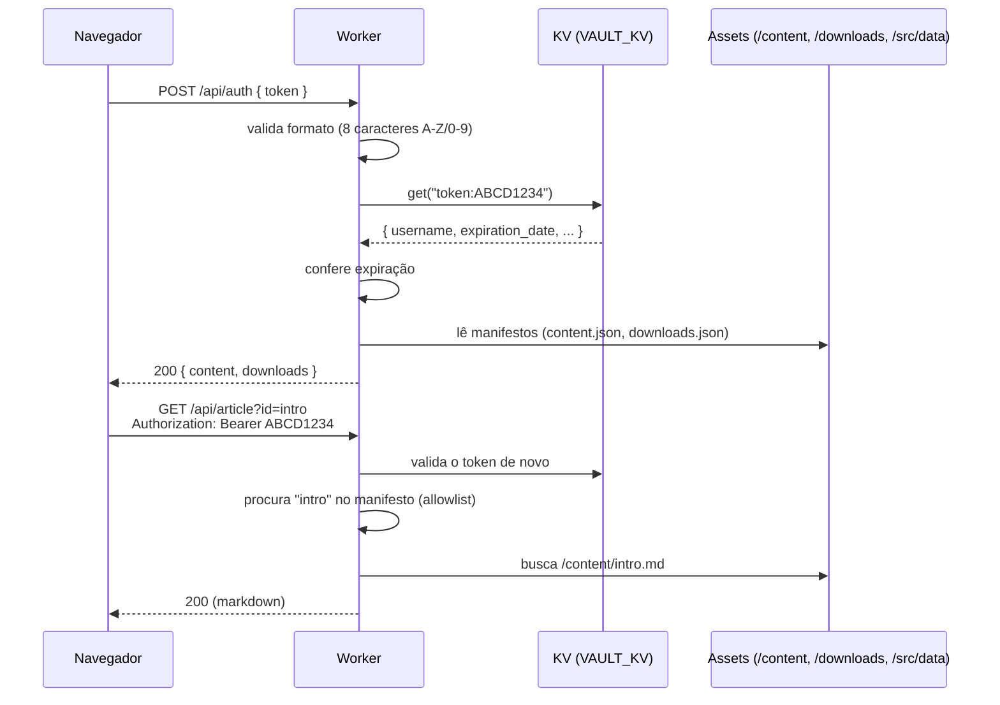

# Skill Vault — autenticação por token (projeto didático)

Projeto-tutorial para ensinar **autenticação simples por token** com Cloudflare Workers + KV e JavaScript vanilla.

O cenário: um acervo pago (wiki em Markdown + downloads em zip/pdf/epub). O cliente recebe um **código de 8 caracteres**; sem ele, nada é lido. Toda a lógica de segurança fica no servidor (Worker) e o frontend é um cliente simples, sem framework e sem build.

> ⚠️ **Projeto educacional.** O sistema é propositalmente simples. Ele é adequado para um produto pequeno, mas tem [limitações conhecidas](#limitações-conhecidas). Leia essa seção antes de usar em produção.

---

## O que você vai aprender

| Conceito | Onde ver |
|---|---|
| O que é um token e por que ele é um "segredo compartilhado" | `_worker.js` → `getValidUser` |
| Nunca confiar na entrada (validação de formato) | `TOKEN_REGEX` |
| Namespaces de chaves no KV (`token:` × `log:`) | `TOKEN_PREFIX` |
| Falhar "fechado" (*fail-closed*) | `parseExpiration` |
| Allowlist × denylist | `PUBLIC_PREFIXES` |
| Normalização de path (bypass com `%63ontent`, `//`, `..`) | `normalizePath` |
| Proxy autenticado de arquivos | `handleArticle`, `handleDownload` |
| Token em header × token na URL | `getTokenFromRequest` |
| XSS: escape de HTML, `onclick` inseguro, event delegation | `utils.js`, `app.js` |
| Race condition em requisições (`AbortController`) | `abrirArtigo` |
| Logout em autenticação *stateless* | `logout` |
| Logs sem perder eventos (e LGPD) | `logAccess` |

---

## Como funciona



Pontos-chave:

1. **O token é a chave do KV.** Não existe tabela de usuários nem sessão: se `token:<código>` existe e não expirou, o acesso é liberado.
2. **Todo pedido revalida o token.** O servidor não "lembra" de ninguém (*stateless*).
3. **O arquivo real nunca é exposto.** O navegador só consegue ler `/content/` e `/downloads/` *através* da API, depois da validação.
4. **O cliente nunca escolhe o caminho do arquivo.** Ele manda um `id`; o caminho vem do manifesto.

---

## Estrutura do projeto

```
/
├── _worker.js               # Worker: rotas, auth, allowlist, proxy, logs
├── index.html               # Shell da aplicação (login + área autenticada)
├── wrangler.toml            # Configuração do Wrangler (binding do KV)
├── README.md
├── .gitignore
├── scripts/
│   └── gerar-token.mjs      # Gera tokens seguros + comando para gravar no KV
├── src/
│   ├── assets/              # Imagens (lock.png = favicon, solid.jpg = logo)
│   ├── data/
│   │   ├── content.json     # Manifesto da wiki (árvore de categorias/itens)
│   │   └── downloads.json   # Manifesto de downloads (lista simples)
│   ├── pages/
│   │   └── privacidade-termos.html
│   ├── scripts/
│   │   ├── app.js           # Orquestração: login, sidebar, artigos, downloads, logout
│   │   ├── utils.js         # escapeHtml, validação do token, markdown seguro
│   │   └── marked.min.js    # Parser de Markdown (client-side)
│   └── styles/
│       └── style.css
├── content/                 # Artigos .md (não versionado neste repo)
└── downloads/               # zip/pdf/epub (não versionado neste repo)
```

### O que é público e o que não é

O Worker usa uma **allowlist**: só estes caminhos são servidos direto ao navegador. Todo o resto responde `404`.

| Público | Protegido (só via API autenticada ou nunca) |
|---|---|
| `/`, `/index.html` | `/content/*` |
| `/src/styles/*` | `/downloads/*` |
| `/src/scripts/*` | `/src/data/*` (manifestos) |
| `/src/assets/*` | `/_worker.js`, `/README.md`, `/wrangler.toml`, `/scripts/*` |
| `/src/pages/*` | qualquer outro caminho |

Criou uma pasta pública nova? Adicione-a em `PUBLIC_PREFIXES` no `_worker.js`.

---

## API

| Rota | Método | Autenticação | Descrição |
|---|---|---|---|
| `/api/auth` | POST | body `{ "token": "..." }` | Valida o token e devolve `{ success, user, content, downloads }` |
| `/api/validate` | POST | body `{ "token": "..." }` | Só responde `{ valid: true/false }` |
| `/api/article?id=X` | GET | `Authorization: Bearer <token>` | Proxy do Markdown |
| `/api/download?id=X` | GET | `Authorization: Bearer <token>` | Proxy do arquivo para download |

Códigos de resposta:

| Código | Significado |
|---|---|
| `200` | OK |
| `400` | Parâmetros ausentes/inválidos ou caminho suspeito |
| `401` | Token inválido, ausente ou expirado |
| `404` | Rota, artigo ou arquivo inexistente |
| `405` | Método não permitido |
| `429` | Bloqueado pelo rate limit da Cloudflare (ver [Produção](#antes-de-ir-para-produção)) |
| `502` | O arquivo está no manifesto, mas não existe em `/content` ou `/downloads` |

---

## Formato do token

- **8 caracteres**, somente `A-Z` e `0-9` (o frontend converte para maiúsculas).
- Gerado pelo `scripts/gerar-token.mjs` com alfabeto sem `I`, `O`, `0`, `1` (fácil de ditar por telefone).
- 32⁸ ≈ **1,1 trilhão** de combinações. Só dígitos seriam apenas 10⁸ (100 milhões): pouco, se alguém puder tentar sem limite.

Registro no KV (chave `token:ABCD1234`):

```json
{
  "username": "Fulano",
  "email": "fulano@email.com",
  "date_created": "2026-11-17",
  "expiration_date": "2027-11-17"
}
```

`expiration_date` aceita:
- `"2027-11-17"` → vale **até 23:59:59 desse dia** (horário de Brasília, configurável em `EXPIRATION_TZ`);
- `"2027-11-17T23:59:59-03:00"` → exatamente esse instante.

Data inválida **nega** o acesso. Sem `expiration_date`, o token não expira.

---

## Onde hospedar

| Hospedagem | Funciona? |
|---|---|
| **Cloudflare Pages** (com `_worker.js` e KV) | ✅ Sistema completo: login, artigos, downloads |
| **GitHub Pages** | ⚠️ Só a parte visual. O GitHub serve apenas arquivos estáticos e **não executa o Worker**, então `/api/auth` não existe e nenhum login funciona. |

Os caminhos no HTML são **relativos** (`src/styles/style.css`, e não `/src/styles/style.css`). Assim a página carrega tanto na raiz de um domínio quanto em um subcaminho, como `usuario.github.io/auth-token/`. Caminhos que começam com `/` apontam para a raiz do domínio e quebram nesse caso (CSS e scripts dão 404).

> Dica de aula: peça aos alunos para trocarem um caminho relativo por absoluto e observarem o erro 404 no console do navegador.

---

## Rodando localmente

### Pré-requisitos
- Node.js 18+
- Conta na Cloudflare (para o KV real)
- [Wrangler](https://developers.cloudflare.com/workers/wrangler/): `npm install -g wrangler`

### 1. Crie o namespace do KV

```bash
wrangler kv namespace create VAULT_KV
```

O comando imprime um `id`. Coloque-o no `wrangler.toml`:

```toml
name = "skill-vault"
pages_build_output_dir = "."
compatibility_date = "2026-01-01"

[[kv_namespaces]]
binding = "VAULT_KV"
id = "COLE_AQUI_O_ID"
```

> As opções do Wrangler mudam entre versões. Se algo não bater, confira a documentação de **Pages Functions → Advanced mode** (`_worker.js`) e de **KV bindings**.

### 2. Crie conteúdo de teste

Como `content/` e `downloads/` não vêm no repositório, crie um artigo de exemplo:

```bash
mkdir content
printf '# Olá!\n\nSe você está lendo isto, o proxy autenticado funciona.\n' > content/intro.md
```

Se não tiver arquivos para download, deixe `src/data/downloads.json` como `[]`. Os ids do `content.json` que não tiverem `.md` correspondente respondem `502`.

### 3. Gere um token

```bash
node scripts/gerar-token.mjs "Aluno Teste" aluno@teste.com 30
```

O script imprime o token, o registro JSON e o comando para gravar no KV. Para desenvolvimento local, grave no KV **local** (troque `--remote` por `--local`).

### 4. Suba o servidor

```bash
wrangler pages dev .
```

Abra a URL exibida (normalmente `http://localhost:8788`) e entre com o token.

---

## Roteiro de testes (com `curl`)

Defina a base e um token válido:

```bash
BASE=http://localhost:8788
TOKEN=SEU_TOKEN_AQUI
```

### Autenticação

| # | Teste | Comando | Esperado |
|---|---|---|---|
| 1 | Login válido | `curl -i -X POST $BASE/api/auth -H "Content-Type: application/json" -d "{\"token\":\"$TOKEN\"}"` | `200` com `success: true` |
| 2 | Token inexistente | mesmo comando com `"token":"ZZZZZZZZ"` | `401` |
| 3 | Formato inválido | com `"token":"abc"` | `401` |
| 4 | Chave de log como token | com `"token":"log:2026-11-17"` | `401` |
| 5 | Sem token | com `{}` | `400` |
| 6 | Token expirado | grave um token com `expiration_date` no passado | `401` "Token expirado" |

O teste **4** é o mais importante: ele prova que o namespace (`token:` × `log:`) e a validação de formato bloqueiam o ataque clássico de usar uma chave interna do KV como senha.

### Artigos e downloads

| # | Teste | Comando | Esperado |
|---|---|---|---|
| 7 | Artigo com token | `curl -i "$BASE/api/article?id=intro" -H "Authorization: Bearer $TOKEN"` | `200` (markdown) |
| 8 | Artigo sem token | `curl -i "$BASE/api/article?id=intro"` | `400` |
| 9 | Token na URL (desligado) | `curl -i "$BASE/api/article?id=intro&token=$TOKEN"` | `400` |
| 10 | `id` malicioso | `curl -i "$BASE/api/article?id=../_worker.js" -H "Authorization: Bearer $TOKEN"` | `400` |
| 11 | `id` inexistente | `curl -i "$BASE/api/article?id=nao-existe" -H "Authorization: Bearer $TOKEN"` | `404` |

### Acesso direto (tem que falhar tudo)

| # | Teste | Comando | Esperado |
|---|---|---|---|
| 12 | Markdown cru | `curl -i $BASE/content/intro.md` | `404` |
| 13 | Codificado | `curl -i "$BASE/%63ontent/intro.md"` | `404` |
| 14 | Barra dupla | `curl -i "$BASE//content/intro.md"` | `404` |
| 15 | Maiúsculas | `curl -i "$BASE/Content/intro.md"` | `404` |
| 16 | Manifesto | `curl -i $BASE/src/data/content.json` | `404` |
| 17 | Código-fonte | `curl -i $BASE/_worker.js` | `404` |
| 18 | `..` codificado | `curl -i --path-as-is "$BASE/src/styles/..%2fdata/content.json"` | `400` |
| 19 | Dupla codificação | `curl -i "$BASE/src/%2564ata/content.json"` | `400` |
| 20 | Estático público | `curl -i $BASE/src/styles/style.css` | `200` |

**Atividade:** antes de rodar, peça aos alunos para *preverem* o resultado de cada linha. Depois, comentem no `_worker.js` a função `normalizePath` e rodem de novo: os testes 13, 14, 18 e 19 passam a mostrar por que ela existe.

---

## Limitações conhecidas

Entender o que este sistema **não** faz é parte da aula.

| Limitação | Por quê | Como melhorar |
|---|---|---|
| **Token compartilhável** | Quem tiver o código entra. Não há vínculo com dispositivo ou pessoa. | Detectar muitos IPs por token (os logs já guardam IP); limitar sessões. |
| **Sem rate limit no código** | Um Worker não guarda estado entre requisições sem um serviço de apoio. | Regra de *Rate Limiting* da Cloudflare em `POST /api/auth` (obrigatório). |
| **Logout só no cliente** | O token é *stateless*: continua válido até expirar. | Lista de revogação no KV, ou tokens de sessão curtos. |
| **Revogar demora um pouco** | O KV é *eventually consistent*. Apagar uma chave pode levar de alguns segundos a cerca de um minuto para valer em todo lugar. | Para revogação imediata, usar Durable Objects ou D1. |
| **"Token expirado" × "Token inválido"** | Mensagens diferentes confirmam que o token já existiu. | Responder sempre "inválido ou expirado" (menos útil, mais seguro). |
| **Token na memória do navegador** | Recarregou a página, precisa logar de novo. | `sessionStorage` + `/api/validate` (mais cômodo, porém legível por qualquer XSS). |
| **Markdown sem sanitização por padrão** | O `marked` não filtra HTML. | Incluir o DOMPurify (veja o comentário no `index.html`). |
| **IP nos logs** | IP é dado pessoal (LGPD). | Informar na política de privacidade, manter TTL curto (hoje 30 dias) ou anonimizar. |

---

## Antes de ir para produção

- [ ] Regra de **Rate Limiting** da Cloudflare em `POST /api/auth` (ex.: 10 requisições/minuto por IP).
- [ ] Todos os tokens no KV com prefixo `token:` e 8 caracteres A-Z/0-9.
- [ ] `ALLOW_TOKEN_IN_QUERY = false` no `_worker.js`.
- [ ] Rodar o [roteiro de testes](#roteiro-de-testes-com-curl) **na URL de produção**.
- [ ] `content/` e `downloads/` presentes no deploy (veja a nota abaixo).
- [ ] Política de privacidade menciona IP, finalidade e prazo de retenção dos logs.
- [ ] DOMPurify ativado se o conteúdo puder vir de terceiros.

**Nota sobre o deploy:** `content/` e `downloads/` estão no `.gitignore`. Se o seu deploy no Cloudflare Pages vier de uma integração com o Git, essas pastas **não chegam** a produção e todo artigo responde `502`. Use `wrangler pages deploy .` a partir da sua máquina (que tem as pastas) ou outra forma de publicar o conteúdo.

---

## Exercícios propostos

1. **Fácil:** gere 3 tokens com validades diferentes e teste cada um (inclusive um já expirado).
2. **Fácil:** adicione uma nova categoria no `content.json` e o `.md` correspondente.
3. **Médio:** faça o `/api/validate` ser usado pelo frontend para restaurar a sessão com `sessionStorage`. Discuta o risco em relação ao XSS.
4. **Médio:** troque as mensagens "expirado"/"inválido" por uma só e discuta o *trade-off* de UX × segurança.
5. **Médio:** ative o DOMPurify e prove (com um `.md` contendo ``) a diferença com e sem ele.
6. **Difícil:** implemente revogação: uma chave `revoked:<token>` no KV que o `getValidUser` consulta.
7. **Difícil:** limite cada token a no máximo N IPs distintos por dia usando os logs.
8. **Desafio:** substitua o token estático por um fluxo de *sessão*: `/api/auth` devolve um token temporário (ex.: 1 hora) e o código de acesso é usado só uma vez.

---

## Stack

- **Cloudflare Workers / Pages** — API e proxy de assets protegidos
- **Cloudflare KV** — tokens e logs
- **JavaScript vanilla** — frontend sem framework e sem build
- **Marked.js** — Markdown no navegador
- **DOMPurify** (opcional) — sanitização do HTML renderizado

## Sobre este repositório

Versão pública, para fins de portfólio e ensino. As pastas `content/` e `downloads/` (conteúdo pago do produto original) não fazem parte do que é publicado: o sistema de autenticação e proxy funciona de forma idêntica com qualquer conteúdo.

## Autor

Guilherme Ribeiro  
[LinkedIn](https://linkedin.com/in/gribeirodev) · [GitHub](https://github.com/liberstack)